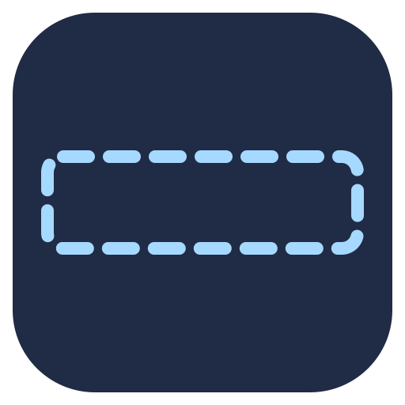

# Smart Top Bar 智能顶栏



[](https://github.com/xingwangzhe/gnome-smart-top-bar/actions/workflows/ci.yml)
[Releases](https://github.com/xingwangzhe/gnome-smart-top-bar/releases) · [问题反馈](https://github.com/xingwangzhe/gnome-smart-top-bar/issues) · [自动测试与发布](ci/README.md)

最大化、纵向最大化和全高度左右平铺时自动隐藏顶栏，释放顶部空间；普通窗口和桌面显示顶栏。鼠标在顶边左右晃两次才呼出，悬停和菜单操作时持续显示，真全屏保持隐藏。

Intelligent GNOME top bar autohide. Shake the pointer twice at the top edge to reveal it. Hovering or using its menus keeps the bar visible; true fullscreen stays undisturbed. Translated preferences use gettext. GNOME 49, 50 and 51 run in the [real compositor CI matrix](.github/workflows/ci.yml).

## 操作

- 鼠标放在**主显示器顶边 3 个逻辑像素**内，连续左右往返两次。两次往返指四段交替横移，例如 `右 → 左 → 右 → 左`，每段至少 36 个逻辑像素，整体在 1.6 秒内完成。
- 单次横移、一次往返和小幅抖动不会呼出。离开顶边、跨屏、按住鼠标按钮、窗口拖动或动作中断会清空手势。
- 呼出后覆盖窗口，不改变应用大小。鼠标离开后延迟 650 毫秒收起，最初显示至少 1 秒。菜单展开、鼠标按住或顶栏键盘导航时保持显示。
- 鼠标停在顶栏应用图标、日期、状态区或空白区域时持续显示；真正离开顶栏才开始隐藏倒计时。
- `Super + Ctrl + B` 临时呼出 / 收起；`Super` 进入概览时照常显示顶栏。
- 真正全屏（游戏、视频、F11 等 Mutter fullscreen 状态）保持隐藏，顶边手势与备用快捷键都不会呼出。退出全屏后恢复智能隐藏。这里依据窗口管理器状态，不按程序名猜测，因此浏览器 F11 也属于真全屏。
- 顶栏保留 GNOME 原有热角。手势宜在顶边中段操作，避免触发左上角热角。

## 安装与管理

从 [GitHub Release](https://github.com/xingwangzhe/gnome-smart-top-bar/releases) 下载 ZIP，通过 GNOME 扩展管理工具安装：

```sh
gnome-extensions install --force smart-top-bar@xingwangzhe.shell-extension.zip
gnome-extensions enable smart-top-bar@xingwangzhe
gnome-extensions prefs smart-top-bar@xingwangzhe
```

若当前 GNOME 会话尚未发现新扩展，注销再登录，然后执行：

```sh
gnome-extensions enable smart-top-bar@xingwangzhe
```

设置窗口跟随系统语言，可以调整每段横移距离、手势时限和隐藏延迟。翻译列表与人口覆盖估算见[国际化说明](i18n/README.md)。也可以用 `gsettings --schemadir ~/.local/share/gnome-shell/extensions/smart-top-bar@xingwangzhe/schemas` 修改对应设置。只需关闭即可还原原始顶栏及其保留空间：

```sh
gnome-extensions disable smart-top-bar@xingwangzhe
```

## 实现与验证

保留原始 panelBox 位置及原生 fullscreen tracking，裁剪其内容，仅平移 Main.panel。隐藏时撤掉顶部 strut，临时呼出保持覆盖方式。没有新增顶部输入区域，没有鼠标抓取，没有常驻外部进程。仅在智能隐藏状态每 40 毫秒被动采样一次，真全屏、概览和普通桌面停止采样。副屏窗口不控制主屏顶栏，切换工作区、显示器变化、锁屏以及禁用时清理状态和资源。

悬停检测读取实际 actor 和 panelBox 的变换后范围，适应面板组件的尺寸调整。当前桌面启用了 Dash in Panel，应用图标与日期组件的位置不被修改。

构建需要 Bun、gettext、GLib schema 工具、zip 和 unzip。运行时测试需要 GJS，以调用 GObject Introspection。

```sh
bun install --frozen-lockfile
bun test
bun run scripts/package.ts
bun run scripts/verify-package.ts
bash tests/nested-smoke.sh
bun run install.ts
```

集成测试在私有 D-Bus、私有配置目录和无头虚拟显示器中运行独立 GNOME Shell，向 compositor 注入真实鼠标和键盘事件。包含手势、悬停保持、菜单、真全屏、工作区切换与禁用恢复，详细门槛和标签发布条件见 [CI 说明](ci/README.md)。

软件渲染测试不能替代所有显卡、真实多屏热插拔、游戏指针锁定和第三方扩展组合的实机验证。未报告 fullscreen 状态的无边框窗口化游戏会按最大化窗口处理。

扩展提供只读诊断接口，不提供任意代码执行或窗口控制：

```sh
gdbus call --session --dest org.gnome.Shell \
  --object-path /io/github/xingwangzhe/SmartTopBar \
  --method io.github.xingwangzhe.SmartTopBar.GetState
```

兼容性参考：[GNOME 50 官方迁移说明](https://gjs.guide/extensions/upgrading/gnome-shell-50.html)；真正全屏依据 [Meta.Window.fullscreen](https://mutter.gnome.org/meta/property.Window.fullscreen.html)。

## 许可与维护

Copyright 2026 xingwangzhe。代码使用 [GPL-3.0-or-later](LICENSE)。Unicode CLDR 数据使用随附许可。项目使用 AI 开发工具辅助编写，功能以可审阅源码、自动测试和公开 CI 记录为依据。
